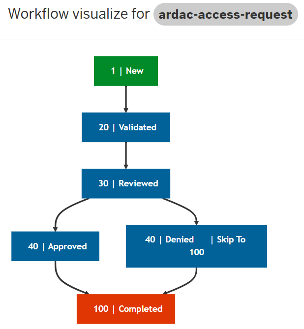

# ARDaC Access Request

## Overview
The ARDaC Access Request process is designed to manage user access to the ARDaC platform. This process ensures that only authorized users can access the platform and its resources.

Form elements include details about the user requesting access, their role, and the specific resources they need access to. Required fields include:
- Email
- Name
- Title
- Organization
- Logon option (CILogon or ORCID)
- Username (if CILogon is selected)
- ORCID (if ORCID is selected)
- Project(s)
- Level of access
- Data use agreement (confirmation of agreement to the data use policy)

## Workflow
When a user submits an access request, the following workflow is initiated:
The user fills out the access request form and submits it.

The submitted request is reviewed by the ARDaC access project team. They verify the user's information and ensure that the request is complete and valid and route to the data managers for review.

The data managers review the request and approve or reject it.

If approved, the form is routed to the system administrator and access is granted.

The form is routed back to the project team to notify the user.

